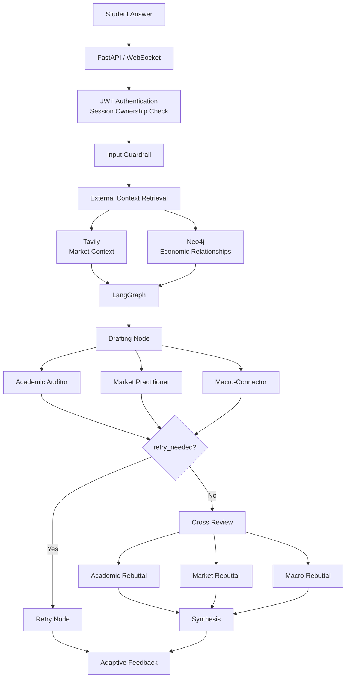
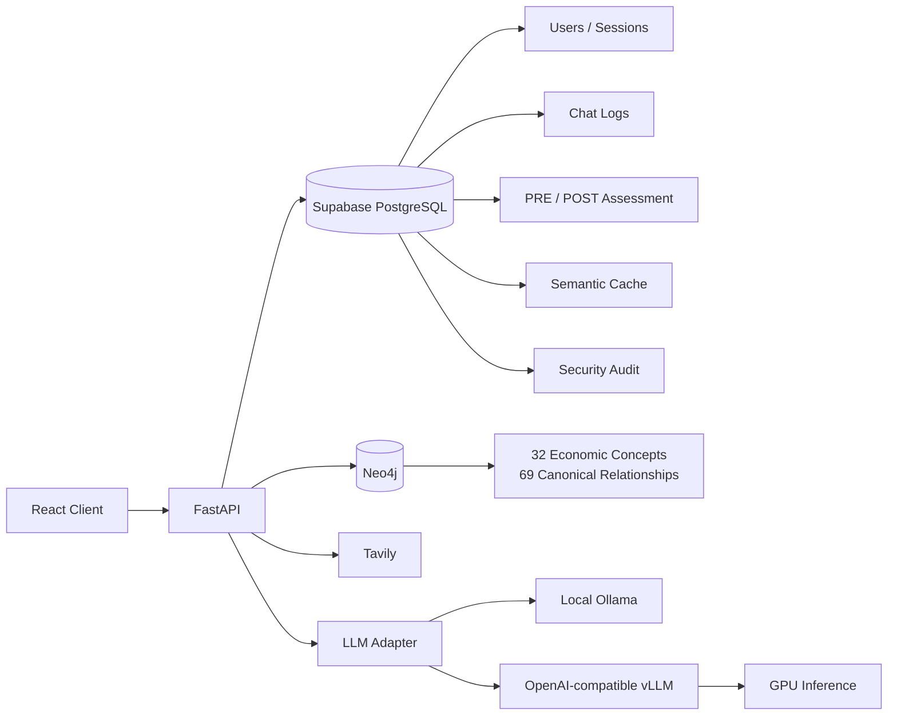
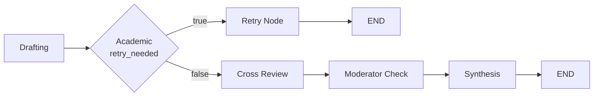
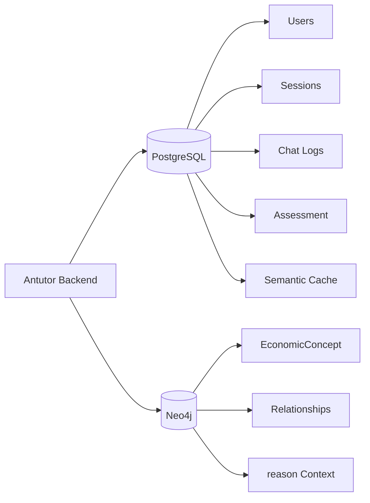
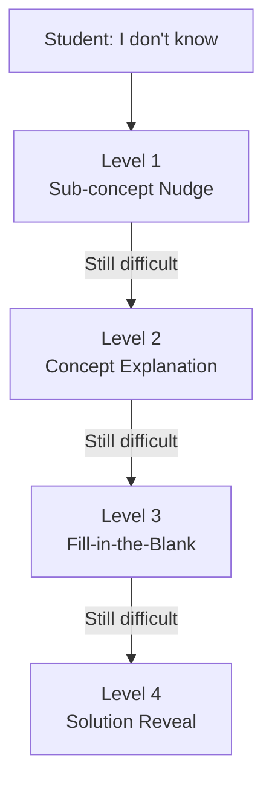

<div align="center">


# Antutor

### Multi-Agent Economics Tutor with Adaptive Scaffolding

**학생이 경제 개념을 직접 설명하면, 서로 다른 관점의 AI Agent가 이를 병렬 검증하고  
학습 상태에 따라 Debate · Retry · Scaffolding 경로를 동적으로 선택하는 AI Tutoring System**

<br/>

[](https://github.com/tangerineYR/antutor/actions/workflows/ci.yml)


</div>

---

## 📌 Overview

**Antutor**는 경제 개념의 정답을 대신 생성해 주는 서비스가 아니라,  
**학습자가 자신의 언어로 개념을 설명하고 그 설명을 여러 관점에서 검증받도록 설계한 Multi-Agent 학습 시스템**입니다.

학생의 답변은 세 명의 Expert Agent가 서로 다른 관점에서 병렬 평가합니다.

- **The Academic Auditor** — 경제학 이론의 정확성과 논리적 일관성 평가
- **The Market Practitioner** — 실제 시장 사례 및 최신 외부 문맥을 기반으로 응용 가능성 평가
- **The Macro-Connector** — 경제 개념 간의 연결 관계와 거시경제적 맥락 평가

단순히 세 Agent의 답변을 나열하는 데 그치지 않고, **LangGraph State Machine**을 통해 답변 상태에 따라 실행 경로를 변경합니다.

```text
Student Answer
      │
      ▼
Guardrail
      │
      ▼
External Context Retrieval
Tavily + Neo4j
      │
      ▼
3 Expert Agents
      │
      ▼
Clause-level Evaluation
      │
      ├── Critical Error ──→ Retry
      │
      └── Normal ──────────→ Cross Review
                                │
                                ▼
                            Synthesis
                                │
                                ▼
                       Adaptive Feedback
```

---

## 🗂️ Project Info

| 항목 | 내용 |
|---|---|
| **프로젝트** | Antutor |
| **유형** | Capstone Design · Team Project |
| **역할** | **Team Lead · Backend · AI Orchestration** |
| **Git 개발 기록** | 2026.03.24 – 2026.06.03 |
| **이후 개선·검증** | 2026.10 이후 |
| **Backend** | FastAPI · WebSocket · LangGraph · asyncio |
| **LLM** | Qwen · Ollama / OpenAI-compatible vLLM |
| **Data** | Supabase PostgreSQL · pgvector · Neo4j |
| **External Context** | Tavily · Neo4j Knowledge Graph |
| **Frontend** | React · Recharts |
| **Original Team Repository** | [Antutor/antutor-repository](https://github.com/Antutor/antutor-repository) |

> **Project Scope & Provenance**
>
> 이 저장소는 [Antutor 팀 프로젝트 원본](https://github.com/Antutor/antutor-repository)을 바탕으로 개인 포트폴리오 용도로 관리하는 Fork입니다.
>
> 팀 프로젝트에서 개발한 Multi-Agent 경제학 학습 시스템을 기반으로 합니다. 개인 개선 범위는 인증·접근 제어, DB 마이그레이션, Semantic Cache 상태 격리, 자동화 테스트 및 로컬 실행 재현성입니다.
>
> `supabase/migrations/`는 백엔드 구조와 프로젝트 설계 자료를 바탕으로 구성한 신규 DB용 마이그레이션입니다.

---

# 🏗️ Architecture

## 1. Multi-Agent Runtime



Tavily와 Neo4j는 서로 다른 Agent context를 구성합니다.

WebSocket chat path에서는 두 context를 `asyncio.gather()`로 병렬 조회하며,
REST `/chat` path에서는 순차적으로 조회합니다.

이와 별개로 LangGraph 내부의 세 Expert Draft와 세 Rebuttal은
각각 `asyncio.gather()`를 통해 병렬 실행합니다.

동시에 무제한 LLM 호출이 발생하지 않도록 `asyncio.Semaphore`를 두어  
**Application-level Parallelism과 Inference Resource Protection을 분리**했습니다.

---

## 2. Data & Inference Architecture



프로젝트 당시에는 **Qwen3-14B-AWQ**를 GCP Compute Engine의 **NVIDIA L4 24GB** 환경에서
vLLM 기반으로 self-hosted serving했습니다.

기본 추론 구성은 **vLLM + Qwen3-14B-AWQ**이며, 로컬 Ollama도 선택할 수 있습니다.
배포 당시 모델·GPU의 출처와 연결 방법은 [GCP/vLLM 가이드](docs/deployment/gcp-vllm.md)에 정리되어 있습니다.

---

# ⚙️ Engineering Highlights

## 1. Evaluation-driven Architecture — NLI/Atomic 구조를 실험으로 폐기

초기 설계에서는 다음과 같은 평가 방식을 비교했습니다.

| 평가 방식 | 전문가 레이블과의 Spearman 상관계수 |
|---|---:|
| **LLM Judge** | **0.66** |
| LLM Atomic | 0.61 |
| Cosine Similarity | 0.55 |
| NLI | 0.16 |

> SemEval-2013 Beetle 전문가 레이블을 활용한 프로젝트 당시 탐색적 비교 실험에서 보고된 값입니다. 공개 자료에는 이 비교의 개별 예측값과 전체 실험 기록이 포함되어 있지 않으므로, 수치의 독립적인 재현까지 검증된 결과로 해석하지 않습니다.

초기에는 `Atomic Decomposition + NLI Guardrail` 구조도 검토했지만,  
실험 결과 Single Judge 방식이 Expert Label과 더 높은 정렬을 보여 최종 구조를 단순화했습니다.

경제 도메인의 답변 평가는 **Academic Agent가 학생의 설명을 Clause 단위로 구조화하여 수행**합니다.

```text
Student Explanation
        │
        ▼
Clause Analysis
        │
        ├── correct
        ├── partial
        └── incorrect
        │
        ▼
Structured Evaluation
```

평가 결과는 Qwen과 LangGraph 기반의 조건부 실행 경로를 결정하는 데 사용합니다.

---

## 2. Conditional LangGraph Orchestration

Antutor의 핵심은 단순히 여러 LLM을 호출하는 것이 아니라  
**학생의 답변 상태에 따라 다음 실행 경로 자체를 변경하는 것**입니다.



Academic Agent가 전체 답변을 핵심적으로 잘못 이해했다고 판단하면  
Cross Review와 일반 Synthesis 경로를 건너뛰고 Retry Node로 직행합니다.

이를 통해 잘못된 전제를 기반으로 불필요한 Agent 토론이 이어지는 것을 막고,
학생에게 먼저 개념을 다시 설명하도록 유도합니다.

---

## 3. Contradiction-first Evaluation & Early Exit

LLM 기반 자동 평가 실험 과정에서  
**정답 키워드를 포함하고 있지만 논리 방향은 틀린 답변이 부분적으로 높은 점수를 받는 문제**를 발견했습니다.

따라서 평가 우선순위를 다음과 같이 설계했습니다.

```text
Fact Extraction
      ↓
Logic Check
      ↓
Completeness Check
      ↓
Final Evaluation
```

Academic Agent가 완전 오답 또는 논리적 모순을 감지하면 `retry_needed=true`를 반환하고,
LangGraph가 이를 다음 routing decision에 직접 사용합니다.

이는 단순 similarity score보다 **논리적 오개념을 우선 차단하기 위한 설계**입니다.

---

## 4. Async Parallelism + Bounded Concurrency

세 Expert Agent는 독립적으로 평가할 수 있으므로 다음과 같이 병렬 실행합니다.

```python
results = await asyncio.gather(
    call_academic(...),
    call_market(...),
    call_macro(...),
)
```

Cross Review 역시 세 Rebuttal Agent를 병렬 실행합니다.

하지만 GPU inference를 무제한 병렬화하면 OOM이나 latency spike가 발생할 수 있기 때문에
LLM invocation 앞에는 별도의 Semaphore를 둡니다.

```text
asyncio.gather()
       │
       ▼
Parallel Agent Tasks
       │
       ▼
asyncio.Semaphore
       │
       ▼
LLM / GPU Endpoint
```

즉 **Concurrency를 없애는 대신, Backend가 허용하는 병렬성과 Inference Resource Capacity를 분리해서 제어**했습니다.

---

## 5. Dual Context Retrieval — Tavily + Neo4j

Market과 Macro Agent는 서로 다른 종류의 외부 문맥을 사용합니다.

### Market Practitioner

```text
Concept / Student Answer
        ↓
Tavily Search
        ↓
Result Filtering
        ↓
Score Ranking
        ↓
Title / URL Deduplication
        ↓
Recent Market Context
```

최신 경제 사례와 시장 정보를 Market Agent에 주입합니다.

### Macro-Connector

```text
Economic Concept
      ↓
Canonical Name Normalization
      ↓
Neo4j
      ↓
1-hop Bidirectional Retrieval
      ↓
Relationship Type + reason
      ↓
Macro Agent Context
```

Neo4j에서는 다음 다섯 가지 관계를 사용합니다.

```text
CAUSES
RELATED_TO
PART_OF
CONTRASTS_WITH
REQUIRES
```

각 Relationship에는 단순 연결 정보뿐 아니라  
**해당 경제학적 관계가 성립하는 이유를 설명하는 `reason` property**를 함께 저장합니다.

Neo4j 조회는 개념을 기준으로 양방향 1-hop 관계와 각 관계의 설명을 가져옵니다.

---

## 6. Reproducible Neo4j Knowledge Graph

원본 관계 데이터는 80개의 source rows로 구성되어 있었습니다.

관계 데이터는 다음 정규화 과정을 거칩니다.

```text
80 Source Rows
      ↓
Unicode / Whitespace Normalization
      ↓
Concept Alias Normalization
      ↓
Symmetric Edge Deduplication
      ↓
69 Canonical Relationships
across 32 Concepts
```

`RELATED_TO`, `CONTRASTS_WITH`는 symmetric relation으로 정규화하고,
`CAUSES`, `PART_OF`, `REQUIRES`는 제공된 방향성을 유지합니다.

```text
neo4j/
├── seed/
│   └── relation_data.csv
├── import.cypher
└── data-provenance.md
```

`MERGE`와 Concept name uniqueness constraint를 사용하여  
**동일 Seed를 반복 실행해도 Graph가 중복 생성되지 않도록 idempotent하게 구성**했습니다.

---

## 7. Semantic Cache — Latency보다 Correctness를 우선한 재설계

프로젝트 당시에는 `all-MiniLM-L6-v2` embedding과 pgvector를 이용하여
유사한 학생 답변의 feedback을 재사용하는 Semantic Cache를 구현했습니다.

### Historical Project Benchmark

프로젝트 당시 Semantic Cache 재사용을 의도한 단일 요청 비교에서 다음 시간이 기록되었습니다.

| 측정 조건 | 기록된 응답 시간 |
|---|---:|
| 전체 LLM 그래프 실행 | **30.314초** |
| Semantic Cache 재사용 시나리오 | **4.228초** |
| 상대적 시간 감소 | **약 86.1%** |

> 프로젝트 당시 각 조건에 요청 1회를 보낸 비교에서 기록한 시간입니다. 반복 측정과 실제 Cache Hit를 확인하는 실행 기록이 없어, 수치는 해당 실험의 관찰값으로 해석합니다. 학습자·세션·프롬프트별로 범위를 구분하는 캐시의 성능 측정과는 구분됩니다.
>
> 자세한 측정 조건과 검증 한계는 [Historical Semantic Cache Benchmark](docs/evaluation/semantic-cache-historical.md)에 정리했습니다.

Semantic Cache는 학습자·세션·프롬프트·모델 상태를 구분하여 학습 맥락에 맞는 피드백을 재사용합니다.

Cache namespace에는 다음 상태가 반영됩니다.

```text
Learner
Session
Concept
Last Question
Exact Answer Hash
Scaffold State
Mastery State
Previous Weakest Agent
Session Context
Synthesis Prompt
Prompt Version
Model Version
```

```text
Embedding Similarity
        +
State Namespace
        +
Prompt / Model Version
        ↓
Safe Synthesis Reuse
```

또한 Cache는 Chat Route를 조기 반환하지 않습니다.

**Guardrail → Expert Evaluation → Scaffolding → Session Update는 매 turn 정상 실행**되고,
Cache Hit 시에는 최종 Retry/Synthesis 결과만 재사용합니다.

캐시 저장과 조회에는 다음 규칙을 적용합니다.

- `VECTOR(384)`
- `all-MiniLM-L6-v2`
- 24-hour TTL
- atomic `hit_count`
- namespace isolation
- failed cache → normal generation fallback

---

## 8. Polyglot Persistence

모든 데이터를 하나의 DB에 넣지 않고 데이터 특성에 따라 저장소를 분리했습니다.



### PostgreSQL / Supabase

사용자·세션·대화·퀴즈 기록을 저장하고, 외래 키와 제약조건으로 데이터 간 관계를 관리합니다.

```text
User
  │
  └── Session
        │
        ├── Chat Logs
        │
        ├── PRE / POST Assessment
        │
        └── Learning State
```

### Neo4j

경제 개념 간의 관계를 탐색하고  
Macro Agent가 사용할 구조화된 external context를 제공합니다.

---

## 9. LLM-oriented Concept Schema

경제 개념을 단일 definition text 하나로 저장하지 않고  
Agent가 목적에 따라 선택적으로 사용할 수 있도록 분리했습니다.

```text
Concept
├── definition
├── acceptable_extensions
├── dict_content
├── key_terms[]
└── defense_prompt
```

이를 통해 같은 개념이라도:

- 기본 정의 검증
- 허용 가능한 추가 설명
- 사전형 콘텐츠
- 핵심 keyword
- 오개념을 파고드는 질문

을 서로 다른 Agent/Prompt에서 선택적으로 활용할 수 있습니다.

---

## 10. Adaptive Scaffolding

학생이 개념 설명에 어려움을 보이면 즉시 답을 공개하는 대신
단계적으로 도움의 강도를 높입니다.



학생이 다시 설명에 성공하면 Scaffolding 경로를 빠져나와 일반 평가 흐름으로 복귀합니다.

이 구조는 정답을 바로 보여주기보다  
**학생이 스스로 설명을 복구할 기회를 단계적으로 제공하는 것**을 목표로 합니다.

---

## 11. Confidence-Based Assessment

PRE / POST Quiz에서는 단순 정오답뿐 아니라  
**학습자가 자신의 답에 얼마나 확신하는지**까지 기록합니다.

### Certainty-Based Marking

| 결과 | Low | Medium | High |
|---|---:|---:|---:|
| Correct | +1 | +2 | +3 |
| Incorrect | 0 | -2 | -6 |

또한 별도의:

```text
Choice 6 = "I don't know"
Confidence = 0
Score = 0
```

응답을 허용합니다.

따라서 시스템은:

```text
틀렸지만 확신함
        ≠
모른다는 것을 알고 있음
```

을 구분할 수 있습니다.

요청 스키마와 신규 DB의 제약조건은 선택지와 확신도가 다음 규칙을 따르도록 검증합니다.

```text
choice == 6  ↔  confidence == 0
```

### Concept-filtered Quiz API

`GET /quiz/{concept}`는 개념명을 정규화하고 `concepts`와 `questions.concept_id`의 관계를 따라 해당 개념의 문항을 최대 5개 조회합니다. 응답에는 문제와 선택지를 제공합니다.

`POST /quiz/submit`는 인증된 사용자의 답안을 받아 DB 정답을 기준으로 CBM 점수를 계산합니다. 빈 답안·중복 문항·다른 개념의 문항을 거부하고, 세션이 지정되면 사용자 소유권과 개념의 일치 여부를 확인합니다.

조회·제출 형식, 오류 응답 및 저장 동작은 [개발 가이드](docs/development.md#quiz-api-contract)에 정리했습니다.

### Learning Gain

POST Quiz는 같은 사용자·세션의 가장 최근 PRE와 비교합니다. 두 답안의 문항 ID 집합과 개수가 일치하면 다음 식으로 학습 향상도를 계산합니다.

\[
g_{\text{runtime}} = \frac{POST - PRE}{MAX - PRE}
\]

`MAX`는 채점 문항 수 × 3입니다. `PRE = MAX`이면 0을 반환하며, 비교할 PRE가 없거나 문항 구성이 다르면 향상도는 `null`입니다.

사용자 평가의 재분석에는 점수 상승과 하락에 서로 다른 분모를 사용하는 정규화 향상도를 사용했습니다. 서비스의 런타임 계산과 평가 통계의 계산 절차는 구분하여 해석합니다.

자세한 평가 공식과 통계적 한계는 [User Evaluation](docs/evaluation/user-evaluation.md)에 정리했습니다.

---

## 12. Backend Security Hardening

백엔드는 인증, 세션 소유권, 요청 출처를 검증하여 데이터와 학습 세션에 대한 접근을 제어합니다.

### Authentication

- `bcrypt` password hashing
- JWT authentication
- 최소 32-byte `SECRET_KEY`
- placeholder / low-diversity secret startup rejection
- Session ownership validation
- 8–72 character password policy
- bcrypt 72-byte boundary validation

### Request Boundary

- Validation error에서 password/request body 제거
- exact-origin CORS allowlist
- WebSocket Origin validation
- WebSocket JWT + Session ownership validation
- Benchmark endpoint default disable + authentication

### LLM Input Guardrail

```text
User Input
    ↓
Prompt Injection / Jailbreak / Harmful Pattern Detection
    │
    ├── Safe → LLM Pipeline
    │
    └── Block
          ↓
    security_logs
```

Security Audit에는 원문 학생 답변이나 matched text를 저장하지 않고:

```text
user_id
threat_type
transport
created_at
```

만 기록합니다.

---

## 13. Backend-only Database Access

신규 DB용 마이그레이션은 브라우저의 테이블·RPC 직접 접근을 차단하고, FastAPI를 통해 데이터를 제공하도록 구성합니다.

```text
React Browser
     │
     X  Direct DB Access
     │
     ▼
FastAPI
     │
service_role
     │
     ▼
PostgreSQL
```

모든 Application Table에 RLS를 활성화하고:

- `PUBLIC`
- `anon`
- `authenticated`

의 직접 Table privilege를 revoke합니다.

`match_semantic_cache*()` RPC 역시 Backend `service_role`에서만 실행할 수 있도록 제한합니다.

퀴즈 조회에서는 문제와 선택지를, PRE 결과에서는 점수를 제공합니다. POST 결과에는 정답·해설·문항별 획득 점수를 함께 제공하여 학습자가 자신의 답안을 검토할 수 있도록 합니다. DB의 정답 데이터는 백엔드에서 조회하고 채점합니다.

---

# 📊 Validation

## Learning Effect

프로젝트 당시 사용자 평가 점수표의 완전한 PRE/POST 쌍 25개를 집계한 결과입니다. 원점수 변화와 정규화 향상도에 대한 검정은 구분하여 제시합니다.

| 평가 항목 | 결과 |
|---|---:|
| 학습 점수 표본 | **25명** |
| PRE Quiz 원점수 평균 | **3.52점** |
| POST Quiz 원점수 평균 | **5.92점** |
| 평균 원점수 변화 | **+2.40점** |
| 원점수 사전·사후 대응표본 t 검정 | **p ≈ 0.204** |
| 정규화 향상도에 대한 일표본 t 검정 | **p ≈ 0.003** |
| 정규화 향상도 효과크기 | **Cohen's d ≈ 0.66** |

원점수의 평균은 상승했지만, 대응표본 t 검정에서는 통상적인 유의수준 0.05에서 통계적으로 유의한 변화가 확인되지 않았습니다.

반면 정규화 향상도를 0과 비교한 일표본 검정에서는 `p ≈ 0.003`이었습니다. 두 검정은 사용하는 지표와 검정 가설이 다르므로 서로 같은 결과로 해석해서는 안 됩니다.

이 수치는 프로젝트 당시 사용자 평가 집계를 재분석한 것으로, 무작위 배정된 비교 실험에서 Antutor의 인과적 우월성을 입증한 결과는 아닙니다.

자세한 평가 집계와 계산 절차는 [User Evaluation](docs/evaluation/user-evaluation.md)을 참고하세요.

비교군 역시 향상을 보였으므로, 이 결과를  
“Antutor가 다른 학습 방식보다 우월하다는 인과적 증명”으로 해석하지 않습니다.

프로젝트 최종 사용자 평가에서는 학습 도움도/힌트 관련 사용자 평가도 함께 수행했으며,
**학습 도움도 4.22/5.0, 4점 이상 25/32명(78.125%)**으로 집계되었습니다.
힌트 적절성은 별도 문항으로 **4.10/5.0(n=31)**이며, 학습 점수 표본(n=25)과 구분합니다.

---

## System Validation

GitHub Actions는 다음 네 영역을 자동으로 검사합니다.

```text
Backend
├── 인증·보안·라우팅·Scaffolding·캐시 단위 테스트
├── 퀴즈 스키마·개념·소유권·채점·오류 처리 테스트
├── 통합 테스트 실행 환경 제한 검사
├── check_api.py: 기본 API·출석·보안 감사·접근 차단
└── check_quiz.py: 개념별 GET·POST 검증·DB 저장·PRE/POST 향상도

Database
├── 신규 DB 마이그레이션 및 동일 파일 재실행
├── 개념 Seed 재실행
├── RLS·권한·퀴즈 제약조건
└── 캐시 카운터·TTL·FK cascade

Frontend
├── npm ci
├── Jest: 기존 테스트·퀴즈 URL 인코딩·빈 상태와 로딩 전환
└── Production Build

Graph
├── Neo4j Startup
├── Canonical Seed
└── Repeatable Import Check
```

단위 테스트와 임시 DB 기반 API 통합 검사로 동작을 검증합니다. 실행 결과는 상단 Verification 배지와 GitHub Actions 로그에서 확인할 수 있습니다.

---

# 🔧 Engineering Decisions & Validation

| 검토 항목 | 설계 결정 | 검증 방법 |
|---|---|---|
| 조건부 Multi-Agent 실행 | Academic Agent의 오류 판단에 따라 Retry 또는 Cross Review 경로 선택 | LangGraph 라우팅 및 Retry 테스트 |
| LLM 호출 자원 관리 | 독립적인 Agent 작업을 병렬 실행하되 Semaphore로 동시 추론 요청 제한 | 비동기 실행 코드 및 추론 호출 구조 검토 |
| Semantic Cache 정확성 | 학습자·세션·프롬프트·모델 상태를 캐시 식별 범위에 반영 | Namespace 격리 및 캐시 동작 테스트 |
| 데이터 접근 통제 | 신규 DB에서 브라우저 직접 접근을 차단하고 FastAPI가 제출 사용자·세션·개념을 검증 | PostgreSQL RLS·권한 검사 및 API 통합 테스트 |
| 사용자 입력 보호 | Prompt Injection 차단과 보안 감사 기록에서 원문·매칭 문자열 제외 | Guardrail 및 보안 감사 테스트 |
| 퀴즈 조회·평가 | 개념별 문항 조회, 빈·중복 답안과 개념 불일치 거부, 서버 CBM 채점 | 스키마·서비스 단위 테스트 및 실제 임시 DB의 GET·POST 통합 검사 |
| 프론트 퀴즈 상태 | 개념명 URL 인코딩, 대기 상태와 빈 문항 배열 구분 | API 함수·QuizScreen 컴포넌트 테스트 |
| 지식그래프 재현성 | 개념명·관계 방향을 정규화하고 중복 없이 Seed 재실행 | Neo4j 시드 및 멱등성 통합 검사 |
| 자동화 검증 | Backend·Database·Frontend·Graph를 분리해 테스트 | GitHub Actions |

자동화 테스트는 API·DB의 입출력과 권한, Agent 라우팅, 프론트 컴포넌트의 동작을 검사합니다. 학습 효과에 대한 실험은 [평가 문서](docs/evaluation/user-evaluation.md)에서 측정 방법과 함께 설명합니다.

---

# 🛠️ Tech Stack

| Category | Technology |
|---|---|
| **Backend** | Python · FastAPI · WebSocket |
| **Agent Orchestration** | LangGraph · LangChain |
| **Concurrency** | asyncio · Semaphore |
| **LLM** | Qwen3 |
| **Default Inference** | vLLM · Qwen3-14B-AWQ |
| **Optional Local Inference** | Ollama · Qwen3 8B |
| **Hosted Inference** | vLLM · OpenAI-compatible API |
| **Project-time GPU Deployment** | GCP Compute Engine · NVIDIA L4 24GB · AWQ |
| **Relational Database** | Supabase PostgreSQL |
| **Vector Retrieval** | pgvector · sentence-transformers · all-MiniLM-L6-v2 |
| **Knowledge Graph** | Neo4j |
| **Web Retrieval** | Tavily |
| **Authentication** | JWT · bcrypt |
| **Translation** | Azure Translator |
| **Frontend** | React · Recharts |
| **Load Testing** | Locust |
| **Infra / Local Reproduction** | Docker Compose · PostgREST · Nginx |
| **Testing** | pytest · Jest |
| **CI** | GitHub Actions |

---

# 📁 Project Structure

아래는 주요 파일을 중심으로 정리한 구조입니다.

```text
antutor/
├── back/
│   ├── main.py
│   ├── config.py
│   ├── security_config.py
│   │
│   ├── routers/
│   │   ├── users.py
│   │   ├── chat.py
│   │   ├── quiz.py
│   │   ├── attendance.py
│   │   ├── benchmark.py
│   │   └── sandbox.py
│   │
│   ├── multi_agent/
│   │   ├── graph.py
│   │   ├── nodes.py
│   │   ├── prompts.py
│   │   ├── state.py
│   │   └── llm_config.py
│   │
│   └── services/
│       ├── semantic_cache.py
│       ├── knowledge_graph.py
│       ├── guardrail.py
│       ├── quiz_service.py
│       ├── translator.py
│       └── concept_normalization.py
│
├── front/
│   ├── src/
│   │   ├── App.js
│   │   ├── api/
│   │   │   ├── services.js
│   │   │   └── services.test.js
│   │   └── components/
│   │       ├── QuizScreen.jsx
│   │       └── QuizScreen.test.jsx
│   └── public/
│
├── supabase/
│   ├── migrations/
│   │   ├── 0001_core_schema.sql
│   │   ├── 0002_learning_assessment.sql
│   │   ├── 0003_semantic_cache.sql
│   │   ├── 0004_security_logs.sql
│   │   └── 0005_access_control.sql
│   │
│   └── seed/
│       ├── concepts.csv
│       ├── concepts.sql
│       ├── concepts.example.sql
│       └── data-provenance.md
│
├── neo4j/
│   ├── seed/
│   │   └── relation_data.csv
│   ├── import.cypher
│   └── data-provenance.md
│
├── tests/
│   ├── test_auth.py
│   ├── test_security.py
│   ├── test_multi_agent_graph.py
│   ├── test_retry_routing.py
│   ├── test_scaffolding.py
│   ├── test_semantic_cache.py
│   ├── test_knowledge_graph.py
│   ├── test_quiz_scoring.py
│   ├── test_integration_environment.py
│   ├── test_websocket_auth.py
│   ├── test_llm_configuration.py
│   ├── integration/
│   │   ├── run_api_check.py
│   │   ├── local_test_environment.py
│   │   ├── check_api.py
│   │   ├── check_quiz.py
│   │   └── check_neo4j.py
│   ├── performance/
│   └── sql/
│
├── scripts/
│   ├── db/
│   ├── diagnostics/
│   ├── evaluation/
│   │   ├── user_evaluation.py
│   │   └── requirements.txt
│   ├── create_local_env.py
│   ├── generate_concept_seed.py
│   └── seed_neo4j.py
│
├── docs/
│   ├── development.md
│   ├── deployment/
│   │   ├── gcp-vllm.md
│   │   └── gcp-vllm-historical.json
│   ├── evaluation/
│   │   ├── data-provenance.md
│   │   ├── semantic-cache-historical.md
│   │   ├── user-evaluation.md
│   │   └── artifacts/
│   │       ├── semantic-cache-historical.png
│   │       └── user-evaluation-summary.json
│   ├── examples/
│   │   └── security-event.json
│   └── experiments/
│       └── vllm_qwen3_colab.ipynb
│
├── .github/
│   └── workflows/
│       └── ci.yml
│
├── compose.yaml
├── requirements.txt
├── requirements-dev.txt
└── README.md
```

---

# 🚀 Quick Start

## 1. Clone

```bash
git clone https://github.com/tangerineYR/antutor.git
cd antutor
```

---

## 2. Backend Environment

Python 3.12를 기준으로 합니다. GPU 추론 서버는 별도로 준비해야 하며, 아래 설치 명령은 백엔드 의존성만 설치합니다.

**Windows PowerShell**

```powershell
python -m venv .venv
.\.venv\Scripts\python.exe -m pip install torch --index-url https://download.pytorch.org/whl/cpu
.\.venv\Scripts\python.exe -m pip install -r requirements-dev.txt
.\.venv\Scripts\python.exe -m pip check
```

**Linux / macOS**

```bash
python3 -m venv .venv
source .venv/bin/activate
python -m pip install torch --index-url https://download.pytorch.org/whl/cpu
python -m pip install -r requirements-dev.txt
python -m pip check
```

Windows에서는 가상환경 활성화 없이 `.\.venv\Scripts\python.exe`를 직접 사용해 스크립트와 테스트를 실행할 수 있습니다.

위 명령은 로컬 설치 예시입니다. CI는 Linux·Python 3.12·Node 22 환경에서 실행합니다. CI의 의존성 버전과 설치 명령은 [워크플로](.github/workflows/ci.yml)를 참고하세요.

---

## 3. Generate Local Secrets

**Windows PowerShell — 저장소 루트**

```powershell
.\.venv\Scripts\python.exe scripts/create_local_env.py
```

**Linux / macOS — 저장소 루트**

```bash
.venv/bin/python scripts/create_local_env.py
```

이 스크립트는 로컬 개발용 `.env`를 새로 생성하며 기존 파일을 덮어쓰지 않습니다. 첫 Docker 실행 전에 생성해야 DB와 PostgREST의 인증 설정이 일치합니다. 생성된 서비스 토큰은 30일 후 만료되며 운영 환경에 사용하지 않습니다. 기존 `.env`나 DB 볼륨이 있으면 설정을 먼저 대조하세요. `.env`의 암호를 바꾸는 것만으로 기존 DB 볼륨의 암호가 변경되지는 않습니다.

실제 Production Secret이나 API Key는 Repository에 commit하지 마세요.

---

## 4. Start Local PostgreSQL / PostgREST

```bash
docker compose --profile api up -d --wait db rest gateway
```

마이그레이션 스크립트는 Bash, `sha256sum`, Docker CLI가 필요합니다. Windows에서는 Docker Desktop에 연결 가능한 Git Bash 또는 WSL에서 저장소 루트를 열어 실행합니다. Linux 컨테이너에 마운트되는 `scripts/db/*.sh` 파일은 LF 줄바꿈이어야 합니다. CRLF로 체크아웃된 경우 실행 전에 LF 여부를 확인하세요.

```bash
bash scripts/db/migrate.sh
```

Concept Seed를 적재합니다.

**Bash**

```bash
docker compose exec -T db \
  psql -U postgres -d antutor -v ON_ERROR_STOP=1 \
  < supabase/seed/concepts.sql
```

**Windows PowerShell — 저장소 루트**

```powershell
cmd /c "docker compose exec -T db psql -U postgres -d antutor -v ON_ERROR_STOP=1 < supabase\seed\concepts.sql"
```

선택적으로 인플레이션 예시 문항 1개를 적재하여 퀴즈 API를 실행해 볼 수 있습니다.

**Bash**

```bash
docker compose exec -T db \
  psql -U postgres -d antutor -v ON_ERROR_STOP=1 \
  < supabase/seed/concepts.example.sql
```

**Windows PowerShell — 저장소 루트**

```powershell
cmd /c "docker compose exec -T db psql -U postgres -d antutor -v ON_ERROR_STOP=1 < supabase\seed\concepts.example.sql"
```

Schema cache를 다시 읽도록 PostgREST를 재시작합니다.

```bash
docker compose restart rest
```

---

## 5. Optional Neo4j

먼저 Neo4j를 실행하고 연결 가능한 상태가 될 때까지 기다립니다.

```bash
docker compose up -d neo4j
```

저장소 루트에서 Seed를 실행합니다.

```powershell
# Windows PowerShell
.\.venv\Scripts\python.exe scripts/seed_neo4j.py
```

```bash
# Linux / macOS
.venv/bin/python scripts/seed_neo4j.py
```

`neo4j/seed/relation_data.csv`를 기준으로
32개 Concept과 69개 Canonical Relationship을 생성합니다.

---

## 6. LLM Backend

기본 설정은 프로젝트 배포와 같은 **vLLM + Qwen3-14B-AWQ**입니다.
별도의 GPU 추론 서버 또는 해당 서버로 연결하는 SSH 터널이 필요합니다.

```env
LLM_BACKEND_TYPE=vllm
LOCAL_LLM_ENDPOINT=http://localhost:8000/v1
DRAFT_LLM_ENDPOINT=http://localhost:8000/v1
DEBATE_LLM_ENDPOINT=http://localhost:8000/v1
LOCAL_LLM_MODEL=Qwen/Qwen3-14B-AWQ
DRAFT_LLM_MODEL=Qwen/Qwen3-14B-AWQ
DEBATE_LLM_MODEL=Qwen/Qwen3-14B-AWQ
```

인증 키, 원격 주소 및 Ollama 선택 방법은 [GCP/vLLM 가이드](docs/deployment/gcp-vllm.md)를 참고하세요.
LLM 서버 없이도 단위 테스트와 로컬 DB/API 검사는 실행할 수 있지만, 실제 AI 응답은 생성되지 않습니다.

---

## 7. Start Backend

저장소 루트에서 시작합니다.

**Windows PowerShell**

```powershell
cd back
..\.venv\Scripts\python.exe -m uvicorn main:app --reload --port 8080
```

**Linux / macOS**

```bash
cd back
../.venv/bin/python -m uvicorn main:app --reload --port 8080
```

---

## 8. Start Frontend

새 terminal에서:

```bash
cd front
npm ci
npm start
```

기본 개발 주소:

```text
Frontend : http://localhost:3000
Backend  : http://localhost:8080
```

웹 화면의 학습 미션은 인플레이션을 중심으로 구성되어 있습니다. 퀴즈 API와 `QuizScreen` 컴포넌트의 사용 방법은 [개발 가이드](docs/development.md#frontend-quiz-scope)를 참고하세요.

---

# 🧪 Tests & CI

## Backend Unit Tests

저장소 루트에서 실행합니다.

**Windows PowerShell**

```powershell
.\.venv\Scripts\python.exe -m pytest -q
```

**Linux / macOS**

```bash
.venv/bin/python -m pytest -q
```

단위 테스트는 외부 의존성을 대체하여 퀴즈·보안·라우팅·캐시 동작과 통합 테스트 실행 조건을 검사합니다. 실제 DB 저장은 API 통합 검사에서 확인합니다.

---

## Database Verification

먼저 Quick Start의 로컬 `.env` 생성 절차를 완료합니다. 아래 검사는 신규·폐기 가능한 로컬 DB용입니다.

**Bash — 저장소 루트**

```bash
docker compose up -d --wait db
bash scripts/db/migrate.sh
bash scripts/db/migrate.sh
docker compose exec -T db psql -U postgres -d antutor -v ON_ERROR_STOP=1 < supabase/seed/concepts.sql
docker compose exec -T db psql -U postgres -d antutor -v ON_ERROR_STOP=1 < supabase/seed/concepts.sql
docker compose exec -T db psql -U postgres -d antutor -v ON_ERROR_STOP=1 < tests/sql/schema_checks.sql
```

Windows에서는 Docker 실행 명령을 PowerShell에서 사용할 수 있습니다. 마이그레이션 두 번 실행은 Git Bash 또는 Docker에 연결된 WSL에서 수행하고, SQL 입력은 저장소 루트의 PowerShell에서 다음처럼 전달합니다.

```powershell
cmd /c "docker compose exec -T db psql -U postgres -d antutor -v ON_ERROR_STOP=1 < supabase\seed\concepts.sql"
cmd /c "docker compose exec -T db psql -U postgres -d antutor -v ON_ERROR_STOP=1 < supabase\seed\concepts.sql"
cmd /c "docker compose exec -T db psql -U postgres -d antutor -v ON_ERROR_STOP=1 < tests\sql\schema_checks.sql"
```

마이그레이션의 두 번째 실행은 checksum ledger에 기록된 동일 파일을 건너뛰는지 확인합니다. 개념 Seed도 두 번 실행하여 중복 적재 없이 재사용되는지 확인합니다.

다음 항목을 실제 PostgreSQL에서 확인합니다.

- RLS 활성화
- `anon` / `authenticated` direct privilege 차단
- Cache RPC permission
- Quiz uncertainty constraint
- Semantic Cache hit counter
- Cache TTL
- FK cascade
- Migration idempotency

---

## API & Quiz Integration

Quick Start의 임시 PostgreSQL·PostgREST·gateway를 실행하고, 마이그레이션과 `concepts.sql`, `concepts.example.sql`을 적용한 뒤 PostgREST를 재시작합니다. 테스트용 API가 사용하는 `127.0.0.1:8082`는 비워 둡니다.

**Windows PowerShell — 저장소 루트**

```powershell
$env:ANTUTOR_DISPOSABLE_TESTS = '1'
.\.venv\Scripts\python.exe tests/integration/run_api_check.py
```

**Bash — 저장소 루트**

```bash
ANTUTOR_DISPOSABLE_TESTS=1 .venv/bin/python tests/integration/run_api_check.py
```

실행기는 로컬 API를 시작해 `check_api.py`와 `check_quiz.py`를 순서대로 실행한 뒤 API 프로세스를 종료합니다. 합성 데이터를 DB에 기록하므로 폐기 가능한 로컬 환경에서 실행합니다. 실행 후 데이터와 볼륨은 [개발 가이드](docs/development.md#api-and-quiz-integration-checks)에 따라 정리합니다.

루트 `.env`와 프로세스 환경변수에는 해당 임시 DB의 `SUPABASE_URL`·`SUPABASE_KEY`를 설정합니다. 프로세스 환경변수가 우선하며, 실행기는 API 주소를 `http://127.0.0.1:8082`로 지정합니다.

퀴즈 통합 검사는 개념별 조회, 빈·중복 답안 및 다른 개념 문항 거부, 세션 소유권, 서버 채점 결과의 저장과 PRE/POST 향상도를 확인합니다. DB 장애 시 오류 반환은 단위 테스트에서 검사합니다.

---

## Frontend

```bash
cd front

npm ci
npm test -- --watchAll=false --runInBand
npm run build
```

프론트 테스트는 API 요청을 mock으로 대체하여 개념명 URL 인코딩과 `QuizScreen`의 빈 결과·로딩 전환·한국어/영어 안내·문항 표시를 검사합니다.

---

## GitHub Actions

Push / Pull Request마다 다음 네 job을 실행합니다.

```text
backend
database
frontend
graph
```

`backend` job은 `ANTUTOR_DISPOSABLE_TESTS=1`을 설정하고 임시 DB·HTTP gateway에서 API·퀴즈 통합 검사를 실행합니다. `frontend` job은 `CI=true`로 테스트와 빌드를 수행합니다. DB와 Graph 검사는 별도 job에서 실행됩니다. Docker를 사용하는 job은 종료 단계에서 해당 CI 환경의 임시 컨테이너와 볼륨을 정리합니다.

실행 결과는 상단 Verification 배지와 각 job의 GitHub Actions 로그에서 확인할 수 있습니다.

---

# 📚 Data Provenance

DB와 Knowledge Graph Seed는 원본 데이터를 임의로 보완하지 않고
출처와 변환 과정을 명시적으로 기록합니다.

### Supabase

[`supabase/seed/data-provenance.md`](./supabase/seed/data-provenance.md)

- 제공받은 Concept Export를 canonical format으로 정리
- 원본 ID와 field 유지
- 빈 row만 제거
- 임의의 definition 생성 금지
- 재실행 가능한 SQL seed 생성

### Neo4j

[`neo4j/data-provenance.md`](./neo4j/data-provenance.md)

- 원본 80 relation rows
- 32 concepts
- 69 canonical relationships
- alias normalization
- symmetric relation deduplication
- causal direction 임의 추론 금지

---

# ⚠️ Scope & Limitations

### 1. Knowledge Graph

지식그래프는 선택한 개념의 양방향 1-hop 관계를 조회하여 Macro Agent의 문맥으로 제공합니다.

### 2. Semantic Cache Benchmark

`30.314s → 4.228s` 결과는 **프로젝트 당시의 단일 broad-cache 실험 결과**입니다.

상태별 namespace를 사용하는 캐시의 설계와 과거 측정의 조건은 [캐시 평가 문서](docs/evaluation/semantic-cache-historical.md)에 정리했습니다.

### 3. Learning Evaluation

`p ≈ 0.003`, `Cohen's d ≈ 0.66`은 **정규화 향상도를 0과 비교한 재계산 결과**이며, 원점수 PRE/POST 검정 결과가 아닙니다.

비교군보다 Antutor가 우월하다는 인과적 결론을 의미하지 않습니다.

### 4. Concept Seed Completeness

Repository의 Concept Seed는 원본 자료의 누락도 그대로 보존합니다.

제공된 30개 Concept 중 일부는 definition 또는 dictionary content가 불완전하므로,
실제 평가용 학습 콘텐츠로 사용할 경우 별도의 domain curation이 필요합니다.

### 5. Supabase Migration

`supabase/migrations/`는 백엔드의 테이블·권한·제약조건을 구성하는 신규 DB용 기준 스키마입니다. 기존 DB에 적용할 때는 스키마와 데이터를 대조하여 환경에 맞는 업그레이드 절차를 준비합니다. [DB 구성 및 적용 방법](docs/development.md#database-baseline)

### 6. LLM Output

Multi-Agent cross review와 structured prompting은 오류 가능성을 줄이기 위한 설계이지만,
LLM의 factual correctness를 절대적으로 보장하지 않습니다.

---

## 📄 License & Usage

이 저장소에는 별도의 오픈소스 라이선스가 부여되어 있지 않습니다.

Antutor는 팀 캡스톤 프로젝트로 개발됐으며, 이 저장소는 원본 팀 프로젝트를 기반으로 한 개인 포트폴리오 Fork입니다. 이후 추가적인 코드 개선과 기술 검증 작업이 반영되어 있지만, 팀 프로젝트에서 비롯된 공동 작업물도 포함되어 있습니다.

따라서 GitHub 이용약관 및 관련 법률에서 허용하는 범위를 제외하고, 저장소 콘텐츠의 사용·수정·재배포·재라이선스 권한을 별도로 부여하지 않습니다.

사용된 외부 라이브러리, API, AI 모델 및 데이터셋 등은 각각의 라이선스와 이용약관을 따릅니다.

---

<div align="center">

**세 가지 관점의 검증, 학습 상태에 맞춰 달라지는 피드백**

**Antutor**

_정답을 대신 제시하기보다, 학습자가 자신의 설명을 검증하고 스스로 다시 생각하도록 돕는 AI 튜터를 설계했습니다._

</div>
