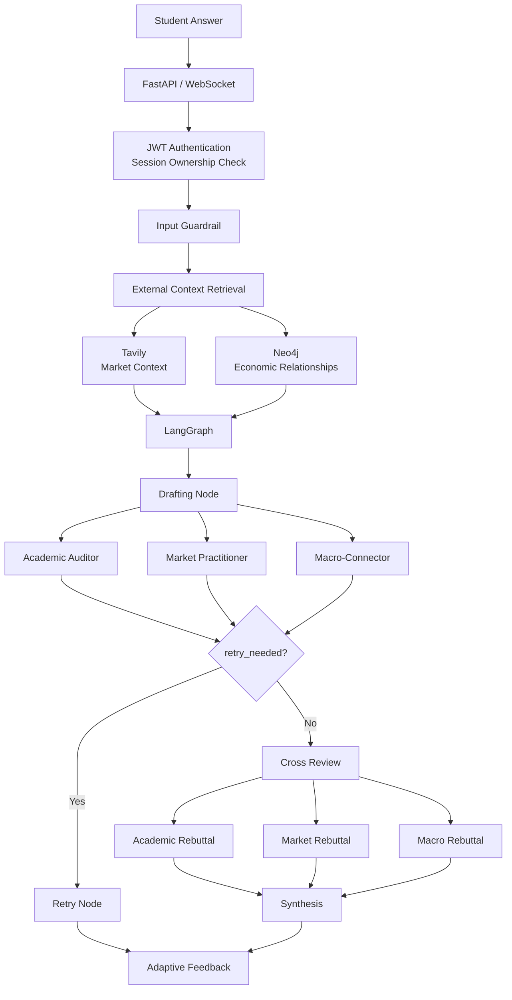
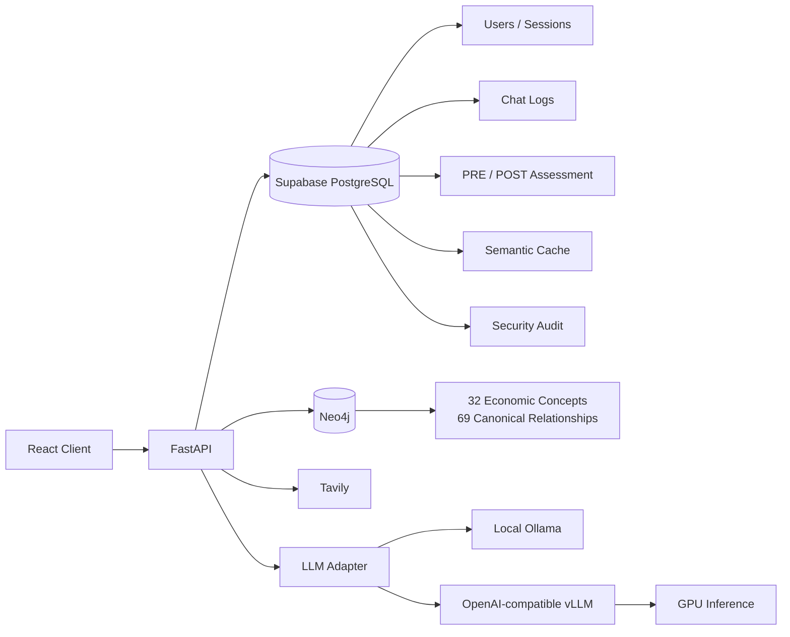
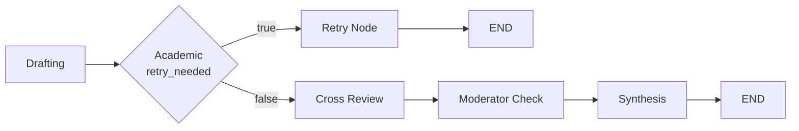
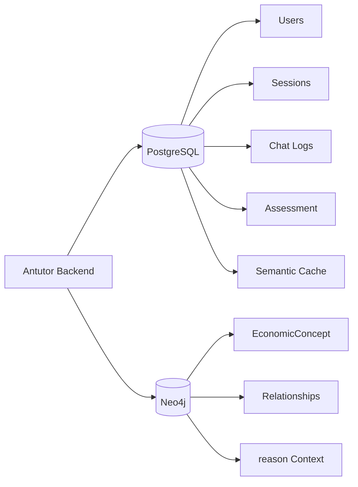
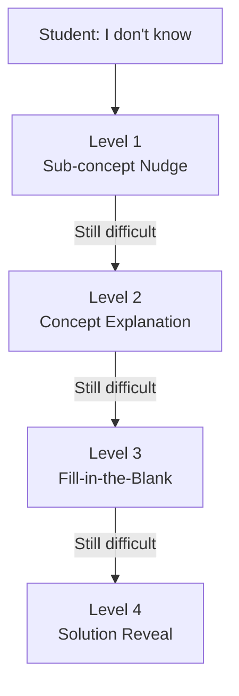

<div align="center">


# Antutor

### Multi-Agent Economics Tutor with Adaptive Scaffolding

**학생이 경제 개념을 직접 설명하면, 서로 다른 관점의 AI Agent가 이를 병렬 검증하고  
학습 상태에 따라 Debate · Retry · Scaffolding 경로를 동적으로 선택하는 AI Tutoring System**

<br/>

[](https://github.com/tangerineYR/antutor/actions/workflows/ci.yml)


</div>

---

## 📌 Overview

**Antutor**는 경제 개념의 정답을 대신 생성해 주는 서비스가 아니라,  
**학습자가 자신의 언어로 개념을 설명하고 그 설명을 여러 관점에서 검증받도록 설계한 Multi-Agent 학습 시스템**입니다.

학생의 답변은 세 명의 Expert Agent가 서로 다른 관점에서 병렬 평가합니다.

- **The Academic Auditor** — 경제학 이론의 정확성과 논리적 일관성 평가
- **The Market Practitioner** — 실제 시장 사례 및 최신 외부 문맥을 기반으로 응용 가능성 평가
- **The Macro-Connector** — 경제 개념 간의 연결 관계와 거시경제적 맥락 평가

단순히 세 Agent의 답변을 나열하는 데 그치지 않고, **LangGraph State Machine**을 통해 답변 상태에 따라 실행 경로를 변경합니다.

```text
Student Answer
      │
      ▼
Guardrail
      │
      ▼
External Context Retrieval
Tavily + Neo4j
      │
      ▼
3 Expert Agents
      │
      ▼
Clause-level Evaluation
      │
      ├── Critical Error ──→ Retry
      │
      └── Normal ──────────→ Cross Review
                                │
                                ▼
                            Synthesis
                                │
                                ▼
                       Adaptive Feedback
```

---

## 🗂️ Project Info

| 항목 | 내용 |
|---|---|
| **프로젝트** | Antutor |
| **유형** | Capstone Design · Team Project |
| **역할** | **Team Lead · Backend · AI Orchestration** |
| **Git 개발 기록** | 2026.03.24 – 2026.06.03 |
| **Portfolio Refactoring** | 2026.10 |
| **Backend** | FastAPI · WebSocket · LangGraph · asyncio |
| **LLM** | Qwen · Ollama / OpenAI-compatible vLLM |
| **Data** | Supabase PostgreSQL · pgvector · Neo4j |
| **External Context** | Tavily · Neo4j Knowledge Graph |
| **Frontend** | React · Recharts |
| **Original Team Repository** | [Antutor/antutor-repository](https://github.com/Antutor/antutor-repository) |

> **Portfolio Refactoring**
>
> 본 저장소는 팀 프로젝트 원본 Repository의 개인 Portfolio Fork입니다.  
> 프로젝트 종료 후 Security Hardening, DB Migration, Cache Correctness, Test/CI,
> Local DB Reproducibility, Neo4j Seed Normalization 등을 추가로 보강했습니다.
>
> `supabase/migrations/`는 과거 Supabase DB의 byte-for-byte dump가 아니라,
> **현재 Backend contract와 프로젝트 당시 DB 설계 자료를 기반으로 재구성한 fresh-database baseline**입니다.

---

# 🏗️ Architecture

## 1. Multi-Agent Runtime



Tavily와 Neo4j는 서로 다른 Agent context를 구성합니다.

WebSocket chat path에서는 두 context를 `asyncio.gather()`로 병렬 조회하며,
REST `/chat` path에서는 현재 순차적으로 조회합니다.

이와 별개로 LangGraph 내부의 세 Expert Draft와 세 Rebuttal은
각각 `asyncio.gather()`를 통해 병렬 실행합니다.

동시에 무제한 LLM 호출이 발생하지 않도록 `asyncio.Semaphore`를 두어  
**Application-level Parallelism과 Inference Resource Protection을 분리**했습니다.

---

## 2. Data & Inference Architecture



프로젝트 당시에는 **Qwen3-14B-AWQ**를 GCP Compute Engine의 **NVIDIA L4 24GB** 환경에서
vLLM 기반으로 self-hosted serving했습니다.

현재 기본 설정은 **vLLM + Qwen3-14B-AWQ**이며, Local Ollama도 선택할 수 있습니다.
배포 당시 모델·GPU의 출처와 연결 방법은 [GCP/vLLM 가이드](docs/deployment/gcp-vllm.md)에 정리되어 있습니다.

---

# ⚙️ Engineering Highlights

## 1. Evaluation-driven Architecture — NLI/Atomic 구조를 실험으로 폐기

초기 설계에서는 다음과 같은 평가 방식을 비교했습니다.

| Evaluation Method | Spearman Correlation |
|---|---:|
| **LLM Judge** | **0.66** |
| LLM Atomic | 0.61 |
| Cosine Similarity | 0.55 |
| NLI | 0.16 |

> SemEval-2013 Beetle의 Expert Label을 이용한 프로젝트 내 비교 실험 결과

초기에는 `Atomic Decomposition + NLI Guardrail` 구조도 검토했지만,  
실험 결과 Single Judge 방식이 Expert Label과 더 높은 정렬을 보여 최종 구조를 단순화했습니다.

현재 구현에서는 이를 경제 도메인에 맞춰 발전시켜  
**Academic Agent가 학생 답변을 Clause 단위로 구조화하여 평가**합니다.

```text
Student Explanation
        │
        ▼
Clause Analysis
        │
        ├── correct
        ├── partial
        └── incorrect
        │
        ▼
Structured Evaluation
```

즉 현재 README의 Architecture는 과거 초기 NLI Prototype이 아니라  
**최종 Qwen + LangGraph 기반 구현**을 기준으로 설명합니다.

---

## 2. Conditional LangGraph Orchestration

Antutor의 핵심은 단순히 여러 LLM을 호출하는 것이 아니라  
**학생의 답변 상태에 따라 다음 실행 경로 자체를 변경하는 것**입니다.



Academic Agent가 전체 답변을 핵심적으로 잘못 이해했다고 판단하면  
Cross Review와 일반 Synthesis 경로를 건너뛰고 Retry Node로 직행합니다.

이를 통해 잘못된 전제를 기반으로 불필요한 Agent 토론이 이어지는 것을 막고,
학생에게 먼저 개념을 다시 설명하도록 유도합니다.

---

## 3. Contradiction-first Evaluation & Early Exit

LLM 기반 자동 평가 실험 과정에서  
**정답 키워드를 포함하고 있지만 논리 방향은 틀린 답변이 부분적으로 높은 점수를 받는 문제**를 발견했습니다.

따라서 평가 우선순위를 다음과 같이 설계했습니다.

```text
Fact Extraction
      ↓
Logic Check
      ↓
Completeness Check
      ↓
Final Evaluation
```

Academic Agent가 완전 오답 또는 논리적 모순을 감지하면 `retry_needed=true`를 반환하고,
LangGraph가 이를 다음 routing decision에 직접 사용합니다.

이는 단순 similarity score보다 **논리적 오개념을 우선 차단하기 위한 설계**입니다.

---

## 4. Async Parallelism + Bounded Concurrency

세 Expert Agent는 독립적으로 평가할 수 있으므로 다음과 같이 병렬 실행합니다.

```python
results = await asyncio.gather(
    call_academic(...),
    call_market(...),
    call_macro(...),
)
```

Cross Review 역시 세 Rebuttal Agent를 병렬 실행합니다.

하지만 GPU inference를 무제한 병렬화하면 OOM이나 latency spike가 발생할 수 있기 때문에
LLM invocation 앞에는 별도의 Semaphore를 둡니다.

```text
asyncio.gather()
       │
       ▼
Parallel Agent Tasks
       │
       ▼
asyncio.Semaphore
       │
       ▼
LLM / GPU Endpoint
```

즉 **Concurrency를 없애는 대신, Backend가 허용하는 병렬성과 Inference Resource Capacity를 분리해서 제어**했습니다.

---

## 5. Dual Context Retrieval — Tavily + Neo4j

Market과 Macro Agent는 서로 다른 종류의 외부 문맥을 사용합니다.

### Market Practitioner

```text
Concept / Student Answer
        ↓
Tavily Search
        ↓
Result Filtering
        ↓
Score Ranking
        ↓
Title / URL Deduplication
        ↓
Recent Market Context
```

최신 경제 사례와 시장 정보를 Market Agent에 주입합니다.

### Macro-Connector

```text
Economic Concept
      ↓
Canonical Name Normalization
      ↓
Neo4j
      ↓
1-hop Bidirectional Retrieval
      ↓
Relationship Type + reason
      ↓
Macro Agent Context
```

Neo4j에서는 다음 다섯 가지 관계를 사용합니다.

```text
CAUSES
RELATED_TO
PART_OF
CONTRASTS_WITH
REQUIRES
```

각 Relationship에는 단순 연결 정보뿐 아니라  
**해당 경제학적 관계가 성립하는 이유를 설명하는 `reason` property**를 함께 저장합니다.

현재 실행 코드는 **1-hop retrieval**을 사용합니다.  
프로젝트 문서에 존재했던 Multi-hop 아이디어를 현재 구현된 기능처럼 과장하지 않습니다.

---

## 6. Reproducible Neo4j Knowledge Graph

원본 관계 데이터는 80개의 source rows로 구성되어 있었습니다.

Portfolio Refactoring에서는 이를 정규화하여:

```text
80 Source Rows
      ↓
Unicode / Whitespace Normalization
      ↓
Concept Alias Normalization
      ↓
Symmetric Edge Deduplication
      ↓
69 Canonical Relationships
across 32 Concepts
```

로 정리했습니다.

`RELATED_TO`, `CONTRASTS_WITH`는 symmetric relation으로 정규화하고,
`CAUSES`, `PART_OF`, `REQUIRES`는 제공된 방향성을 유지합니다.

```text
neo4j/
├── seed/
│   └── relation_data.csv
├── import.cypher
└── data-provenance.md
```

`MERGE`와 Concept name uniqueness constraint를 사용하여  
**동일 Seed를 반복 실행해도 Graph가 중복 생성되지 않도록 idempotent하게 구성**했습니다.

---

## 7. Semantic Cache — Latency보다 Correctness를 우선한 재설계

프로젝트 당시에는 `all-MiniLM-L6-v2` embedding과 pgvector를 이용하여
유사한 학생 답변의 feedback을 재사용하는 Semantic Cache를 구현했습니다.

### Historical Project Benchmark

단일 semantic-equivalence 검증 시나리오에서는:

| Scenario | Response Time |
|---|---:|
| Full LLM Graph | **30.314 s** |
| Semantic Cache Hit | **4.228 s** |
| Reduction | **약 86.1%** |

> 이 수치는 프로젝트 당시의 broad semantic cache에 대한 단일 시나리오 측정 결과입니다.  
> 현재 Portfolio 버전의 end-to-end benchmark를 의미하지 않습니다.
> [당시 차트·측정 조건·확인 한계](docs/evaluation/semantic-cache-historical.md)

Portfolio Refactoring에서는 hit rate보다 **pedagogical correctness**를 우선하도록 Cache를 보수적으로 변경했습니다.

현재 Cache namespace에는 다음 상태가 반영됩니다.

```text
Learner
Session
Concept
Last Question
Exact Answer Hash
Scaffold State
Mastery State
Previous Weakest Agent
Session Context
Synthesis Prompt
Prompt Version
Model Version
```

```text
Embedding Similarity
        +
State Namespace
        +
Prompt / Model Version
        ↓
Safe Synthesis Reuse
```

또한 Cache는 Chat Route를 조기 반환하지 않습니다.

**Guardrail → Expert Evaluation → Scaffolding → Session Update는 매 turn 정상 실행**되고,
Cache Hit 시에는 최종 Retry/Synthesis 결과만 재사용합니다.

현재 구현은:

- `VECTOR(384)`
- `all-MiniLM-L6-v2`
- 24-hour TTL
- atomic `hit_count`
- namespace isolation
- failed cache → normal generation fallback

을 지원합니다.

---

## 8. Polyglot Persistence

모든 데이터를 하나의 DB에 넣지 않고 데이터 특성에 따라 저장소를 분리했습니다.



### PostgreSQL / Supabase

트랜잭션 무결성과 상태 추적이 필요한 데이터를 저장합니다.

```text
User
  │
  └── Session
        │
        ├── Chat Logs
        │
        ├── PRE / POST Assessment
        │
        └── Learning State
```

### Neo4j

경제 개념 간의 관계를 탐색하고  
Macro Agent가 사용할 구조화된 external context를 제공합니다.

---

## 9. LLM-oriented Concept Schema

경제 개념을 단일 definition text 하나로 저장하지 않고  
Agent가 목적에 따라 선택적으로 사용할 수 있도록 분리했습니다.

```text
Concept
├── definition
├── acceptable_extensions
├── dict_content
├── key_terms[]
└── defense_prompt
```

이를 통해 같은 개념이라도:

- 기본 정의 검증
- 허용 가능한 추가 설명
- 사전형 콘텐츠
- 핵심 keyword
- 오개념을 파고드는 질문

을 서로 다른 Agent/Prompt에서 선택적으로 활용할 수 있습니다.

---

## 10. Adaptive Scaffolding

학생이 개념 설명에 어려움을 보이면 즉시 답을 공개하는 대신
단계적으로 도움의 강도를 높입니다.



학생이 다시 설명에 성공하면 Scaffolding 경로를 빠져나와 일반 평가 흐름으로 복귀합니다.

이 구조는 정답을 바로 보여주기보다  
**학생이 스스로 설명을 복구할 기회를 단계적으로 제공하는 것**을 목표로 합니다.

---

## 11. Confidence-Based Assessment

PRE / POST Quiz에서는 단순 정오답뿐 아니라  
**학습자가 자신의 답에 얼마나 확신하는지**까지 기록합니다.

### Certainty-Based Marking

| 결과 | Low | Medium | High |
|---|---:|---:|---:|
| Correct | +1 | +2 | +3 |
| Incorrect | 0 | -2 | -6 |

또한 별도의:

```text
Choice 6 = "I don't know"
Confidence = 0
Score = 0
```

응답을 허용합니다.

따라서 시스템은:

```text
틀렸지만 확신함
        ≠
모른다는 것을 알고 있음
```

을 구분할 수 있습니다.

DB와 Pydantic 양쪽에서 다음 invariant를 검증합니다.

```text
choice == 6  ↔  confidence == 0
```

POST Quiz에서는 PRE score와 비교하여 **Hake's Normalized Gain**도 계산합니다.

\[
g = \frac{Post - Pre}{Perfect - Pre}
\]

---

## 12. Backend Security Hardening

Portfolio Refactoring에서는 기능 추가뿐 아니라
공개 Repository에 적합하도록 Security Boundary를 재설계했습니다.

### Authentication

- `bcrypt` password hashing
- JWT authentication
- 최소 32-byte `SECRET_KEY`
- placeholder / low-diversity secret startup rejection
- Session ownership validation
- 8–72 character password policy
- bcrypt 72-byte boundary validation

### Request Boundary

- Validation error에서 password/request body 제거
- exact-origin CORS allowlist
- WebSocket Origin validation
- WebSocket JWT + Session ownership validation
- Benchmark endpoint default disable + authentication

### LLM Input Guardrail

```text
User Input
    ↓
Prompt Injection / Jailbreak / Harmful Pattern Detection
    │
    ├── Safe → LLM Pipeline
    │
    └── Block
          ↓
    security_logs
```

Security Audit에는 원문 학생 답변이나 matched text를 저장하지 않고:

```text
user_id
threat_type
transport
created_at
```

만 기록합니다.

---

## 13. Backend-only Database Access

현재 Portfolio DB baseline은 Browser가 Supabase Table이나 RPC에 직접 접근하지 않도록 구성합니다.

```text
React Browser
     │
     X  Direct DB Access
     │
     ▼
FastAPI
     │
service_role
     │
     ▼
PostgreSQL
```

모든 Application Table에 RLS를 활성화하고:

- `PUBLIC`
- `anon`
- `authenticated`

의 직접 Table privilege를 revoke합니다.

`match_semantic_cache*()` RPC 역시 Backend `service_role`에서만 실행할 수 있도록 제한합니다.

특히 Quiz 정답인 `correct_option`은 Browser가 DB에서 직접 읽지 못하고,
FastAPI가 문제/선택지만 전달한 뒤 서버에서 채점합니다.

---

# 📊 Validation

## Learning Effect

프로젝트 사용자 평가의 점수표(n=25)에서 Antutor 사용 전후의 CBM 원점수 평균은:

```text
PRE   3.52
      ↓
POST  5.92
```

으로 향상되었습니다.

| Metric | Result |
|---|---:|
| Participants | **n = 25** |
| PRE → POST (원점수 평균) | **3.52 → 5.92** |
| 정규화 향상도 vs 0 (일표본 t 검정) | **p ≈ 0.003** |
| 정규화 향상도 효과크기 | **Cohen's d ≈ 0.66** |

위 p와 d는 **공개 평가 집계의 정규화 향상도를 0과 비교하여 계산한 결과**입니다.
원점수 사전·사후 대응표본 검정은 p≈0.204이며, 두 분석을 구분해야 합니다.
[평가 집계·수식·재현 코드](docs/evaluation/user-evaluation.md)

비교군 역시 향상을 보였으므로, 이 결과를  
“Antutor가 다른 학습 방식보다 우월하다는 인과적 증명”으로 해석하지 않습니다.

프로젝트 최종 사용자 평가에서는 학습 도움도/힌트 관련 사용자 평가도 함께 수행했으며,
**학습 도움도 4.22/5.0, 4점 이상 25/32명(78.125%)**으로 집계되었습니다.
힌트 적절성은 별도 문항으로 **4.10/5.0(n=31)**이며, 학습 점수 표본(n=25)과 구분합니다.

---

## System Validation

현재 Portfolio Repository의 GitHub Actions에서는 다음을 자동 검증합니다.

```text
Backend
├── Unit Tests
├── Security Tests
├── Multi-Agent Routing Tests
├── Semantic Cache Tests
├── Quiz / Scaffolding Tests
└── Local API Integration

Database
├── Migration
├── Migration Re-run / Idempotency
├── RLS / Privilege Check
├── Quiz Constraints
├── Cache Counter / TTL
└── Cascade Integrity

Frontend
├── npm ci
├── Jest Tests
└── Production Build

Graph
├── Neo4j Startup
├── Canonical Seed
└── Repeatable Import Check
```

**Backend 86 tests**와 로컬 API 통합 검사로 동작을 확인합니다.
Backend / Database / Frontend / Graph CI 결과는 상단 Verification 배지에서 확인할 수 있습니다.

---

# 🛠️ Tech Stack

| Category | Technology |
|---|---|
| **Backend** | Python · FastAPI · WebSocket |
| **Agent Orchestration** | LangGraph · LangChain |
| **Concurrency** | asyncio · Semaphore |
| **LLM** | Qwen3 |
| **Default Inference** | vLLM · Qwen3-14B-AWQ |
| **Optional Local Inference** | Ollama · Qwen3 8B |
| **Hosted Inference** | vLLM · OpenAI-compatible API |
| **Project-time GPU Deployment** | GCP Compute Engine · NVIDIA L4 24GB · AWQ |
| **Relational Database** | Supabase PostgreSQL |
| **Vector Retrieval** | pgvector · sentence-transformers · all-MiniLM-L6-v2 |
| **Knowledge Graph** | Neo4j |
| **Web Retrieval** | Tavily |
| **Authentication** | JWT · bcrypt |
| **Translation** | Azure Translator |
| **Frontend** | React · Recharts |
| **Load Testing** | Locust |
| **Infra / Local Reproduction** | Docker Compose · PostgREST · Nginx |
| **Testing** | pytest · Jest |
| **CI** | GitHub Actions |

---

# 📁 Project Structure

```text
antutor/
├── back/
│   ├── main.py
│   ├── config.py
│   ├── security_config.py
│   │
│   ├── routers/
│   │   ├── users.py
│   │   ├── chat.py
│   │   ├── quiz.py
│   │   ├── attendance.py
│   │   ├── benchmark.py
│   │   └── sandbox.py
│   │
│   ├── multi_agent/
│   │   ├── graph.py
│   │   ├── nodes.py
│   │   ├── prompts.py
│   │   ├── state.py
│   │   └── llm_config.py
│   │
│   └── services/
│       ├── semantic_cache.py
│       ├── knowledge_graph.py
│       ├── guardrail.py
│       ├── quiz_service.py
│       ├── translator.py
│       └── concept_normalization.py
│
├── front/
│   ├── src/
│   └── public/
│
├── supabase/
│   ├── migrations/
│   │   ├── 0001_core_schema.sql
│   │   ├── 0002_learning_assessment.sql
│   │   ├── 0003_semantic_cache.sql
│   │   ├── 0004_security_logs.sql
│   │   └── 0005_access_control.sql
│   │
│   └── seed/
│       ├── concepts.csv
│       ├── concepts.sql
│       └── data-provenance.md
│
├── neo4j/
│   ├── seed/
│   │   └── relation_data.csv
│   ├── import.cypher
│   └── data-provenance.md
│
├── tests/
│   ├── test_auth.py
│   ├── test_security.py
│   ├── test_multi_agent_graph.py
│   ├── test_retry_routing.py
│   ├── test_semantic_cache.py
│   ├── test_knowledge_graph.py
│   ├── test_scaffolding.py
│   ├── test_quiz_scoring.py
│   ├── test_websocket_auth.py
│   ├── test_llm_configuration.py
│   ├── integration/
│   ├── performance/
│   └── sql/
│
├── scripts/
│   ├── db/
│   ├── diagnostics/
│   ├── evaluation/
│   │   ├── user_evaluation.py
│   │   └── requirements.txt
│   ├── create_local_env.py
│   ├── generate_concept_seed.py
│   └── seed_neo4j.py
│
├── docs/
│   ├── development.md
│   ├── deployment/
│   │   ├── gcp-vllm.md
│   │   └── gcp-vllm-historical.json
│   ├── evaluation/
│   │   ├── data-provenance.md
│   │   ├── semantic-cache-historical.md
│   │   ├── user-evaluation.md
│   │   └── artifacts/
│   │       ├── semantic-cache-historical.png
│   │       └── user-evaluation-summary.json
│   ├── examples/
│   │   └── security-event.json
│   └── experiments/
│       └── vllm_qwen3_colab.ipynb
│
├── .github/
│   └── workflows/
│       └── ci.yml
│
├── compose.yaml
├── requirements.txt
├── requirements-dev.txt
└── README.md
```

---

# 🚀 Quick Start

## 1. Clone

```bash
git clone https://github.com/tangerineYR/antutor.git
cd antutor
```

---

## 2. Backend Environment

Python 3.12 기준입니다.

```bash
python -m venv .venv
source .venv/bin/activate

python -m pip install torch --index-url https://download.pytorch.org/whl/cpu
python -m pip install -r requirements-dev.txt
```

Windows에서는:

```powershell
.venv\Scripts\activate
```

를 사용합니다.

---

## 3. Generate Local Secrets

```bash
python scripts/create_local_env.py
```

이 스크립트는 local development용 `.env`를 생성합니다.

실제 Production Secret이나 API Key는 Repository에 commit하지 마세요.

---

## 4. Start Local PostgreSQL / PostgREST

```bash
docker compose --profile api up -d --wait db rest gateway
```

Migration을 적용합니다.

```bash
bash scripts/db/migrate.sh
```

Concept Seed를 적재합니다.

```bash
docker compose exec -T db \
  psql -U postgres -d antutor -v ON_ERROR_STOP=1 \
  < supabase/seed/concepts.sql
```

Optional example question:

```bash
docker compose exec -T db \
  psql -U postgres -d antutor -v ON_ERROR_STOP=1 \
  < supabase/seed/concepts.example.sql
```

Schema cache를 다시 읽도록 PostgREST를 재시작합니다.

```bash
docker compose restart rest
```

---

## 5. Optional Neo4j

```bash
docker compose up -d neo4j
python scripts/seed_neo4j.py
```

`neo4j/seed/relation_data.csv`를 기준으로
32개 Concept과 69개 Canonical Relationship을 생성합니다.

---

## 6. LLM Backend

기본 설정은 프로젝트 배포와 같은 **vLLM + Qwen3-14B-AWQ**입니다.
별도의 GPU 추론 서버 또는 해당 서버로 연결하는 SSH 터널이 필요합니다.

```env
LLM_BACKEND_TYPE=vllm
LOCAL_LLM_ENDPOINT=http://localhost:8000/v1
DRAFT_LLM_ENDPOINT=http://localhost:8000/v1
DEBATE_LLM_ENDPOINT=http://localhost:8000/v1
LOCAL_LLM_MODEL=Qwen/Qwen3-14B-AWQ
DRAFT_LLM_MODEL=Qwen/Qwen3-14B-AWQ
DEBATE_LLM_MODEL=Qwen/Qwen3-14B-AWQ
```

인증 키, 원격 주소 및 Ollama 선택 방법은 [GCP/vLLM 가이드](docs/deployment/gcp-vllm.md)를 참고하세요.
LLM 서버 없이도 단위 테스트와 로컬 DB/API 검사는 실행할 수 있지만, 실제 AI 응답은 생성되지 않습니다.

---

## 7. Start Backend

```bash
cd back
uvicorn main:app --reload --port 8080
```

---

## 8. Start Frontend

새 terminal에서:

```bash
cd front
npm ci
npm start
```

기본 개발 주소:

```text
Frontend : http://localhost:3000
Backend  : http://localhost:8080
```

---

# 🧪 Tests & CI

## Backend Unit Tests

```bash
pytest -q
```

백엔드 테스트 결과:

```text
86 passed
```

---

## Database Verification

```bash
docker compose up -d --wait db

bash scripts/db/migrate.sh

docker compose exec -T db \
  psql -U postgres -d antutor -v ON_ERROR_STOP=1 \
  < tests/sql/schema_checks.sql
```

다음 항목을 실제 PostgreSQL에서 확인합니다.

- RLS 활성화
- `anon` / `authenticated` direct privilege 차단
- Cache RPC permission
- Quiz uncertainty constraint
- Semantic Cache hit counter
- Cache TTL
- FK cascade
- Migration idempotency

---

## Frontend

```bash
cd front

npm ci
npm test -- --watchAll=false --runInBand
npm run build
```

---

## GitHub Actions

Push / Pull Request마다 다음 네 job을 실행합니다.

```text
backend
database
frontend
graph
```

최신 실행 결과는 상단 Verification 배지와 GitHub Actions에서 확인할 수 있습니다.

---

# 📚 Data Provenance

DB와 Knowledge Graph Seed는 원본 데이터를 임의로 보완하지 않고
출처와 변환 과정을 명시적으로 기록합니다.

### Supabase

[`supabase/seed/data-provenance.md`](./supabase/seed/data-provenance.md)

- 제공받은 Concept Export를 canonical format으로 정리
- 원본 ID와 field 유지
- 빈 row만 제거
- 임의의 definition 생성 금지
- 재실행 가능한 SQL seed 생성

### Neo4j

[`neo4j/data-provenance.md`](./neo4j/data-provenance.md)

- 원본 80 relation rows
- 32 concepts
- 69 canonical relationships
- alias normalization
- symmetric relation deduplication
- causal direction 임의 추론 금지

---

# ⚠️ Scope & Limitations

### 1. Knowledge Graph

현재 Runtime retrieval은 **1-hop**입니다.

프로젝트 문서에서 검토했던 Multi-hop Graph Traversal은
현재 실행 코드의 기능으로 주장하지 않습니다.

### 2. Semantic Cache Benchmark

`30.314s → 4.228s` 결과는 **프로젝트 당시의 단일 broad-cache 실험 결과**입니다.

현재 Portfolio Cache는 learner/session/prompt/model state까지 namespace에 포함하는
더 보수적인 구조이므로 동일 수치를 현재 구현의 성능이라고 해석할 수 없습니다.

### 3. Learning Evaluation

`p ≈ 0.003`, `Cohen's d ≈ 0.66`은 **정규화 향상도를 0과 비교한 재계산 결과**이며, 원점수 PRE/POST 검정 결과가 아닙니다.

비교군보다 Antutor가 우월하다는 인과적 결론을 의미하지 않습니다.

### 4. Concept Seed Completeness

Repository의 Concept Seed는 원본 자료의 누락도 그대로 보존합니다.

현재 제공된 30개 Concept 중 일부는 definition 또는 dictionary content가 불완전하므로,
실제 평가용 학습 콘텐츠로 사용할 경우 별도의 domain curation이 필요합니다.

### 5. Supabase Migration

`supabase/migrations/`는 과거 Production Supabase를 그대로 export한 dump가 아니라
**현재 Backend contract를 재현하기 위해 복원한 fresh-database baseline**입니다.

기존 Production DB에 그대로 적용하기보다 새 DB 또는 migration upgrade 검토 후 사용하는 것을 권장합니다.

### 6. LLM Output

Multi-Agent cross review와 structured prompting은 오류 가능성을 줄이기 위한 설계이지만,
LLM의 factual correctness를 절대적으로 보장하지 않습니다.

---

## 📄 License & Usage

This repository does not currently grant a separate open-source license.

Antutor was originally developed as a team capstone project, and this repository
is a personal portfolio fork of the original team repository. The portfolio
version includes additional refactoring and engineering work, but the repository
also contains work originating from the team project.

Accordingly, no permission to use, modify, redistribute, or sublicense the
repository contents is granted beyond rights provided by GitHub's Terms of Service
or applicable law.

Third-party libraries, APIs, models, datasets, and other external resources remain
subject to their respective licenses and terms of use.

---

<div align="center">

### Three perspectives. One adaptive tutor.

**Antutor**

학생에게 답을 대신 주는 AI가 아니라,  
**학생의 설명을 듣고 다시 생각하게 만드는 AI Tutor를 설계했습니다.**

</div>
