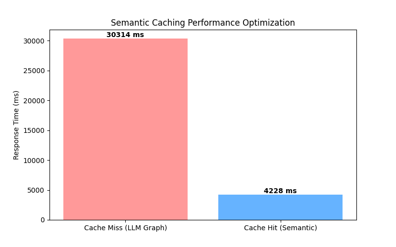

# Historical Semantic Cache Benchmark

출처는 [원본 차트](artifacts/semantic-cache-historical.png)와 [`1c5e5ba`의 `semantic_caching_test.py`](https://github.com/tangerineYR/antutor/blob/1c5e5ba/performance_test/semantic_caching_test.py)입니다. 과거 Git 산출물이며 상태별 캐시의 측정 결과가 아닙니다. 이미지 식별 정보는 [출처 문서](data-provenance.md)에 기록되어 있습니다.

| 측정 조건 | 기록된 응답 시간 |
|---|---:|
| 전체 LLM 그래프 실행 시나리오 | 30.314초 |
| Semantic Cache 재사용 시나리오 | 4.228초 |
| 상대적 시간 감소 `(30314-4228)/30314 × 100` | 86.0526% (약 86.1%) |

## Measurement Procedure

과거 스크립트는 인플레이션을 서로 다르게 서술한 두 `POST /chat` 요청을 순차 전송합니다. 사용자·세션은 서로 다르며 요청 사이에 1.5초를 기다립니다. 클라이언트 경과 시간은 `time.time()`으로 측정하고 차트 레이블은 정수 밀리초로 절삭합니다.

조건마다 요청은 1회이며 반복 측정의 분산이나 신뢰구간은 없습니다. 스크립트는 요청 전에 선택된 세션 로그와 개념 캐시 항목을 지웁니다. 이러한 세션 간 재사용 시나리오는 과거의 넓은 캐시 범위에 해당합니다. 학습자·세션·상태별 synthesis 캐시는 같은 방식의 재사용을 의도적으로 막습니다.

## Limits

- 해당 커밋은 차트와 절차를 보존하지만 이미지를 정확한 서버 커밋·GPU·모델 revision·vLLM 이미지 digest와 연결하는 실행 ID가 없습니다.
- 스크립트는 HTTP 오류를 출력해도 소요 시간을 반환하며 `from_cache`를 검증하지 않습니다. 이미지만으로 요청 성공이나 실제 캐시 적중을 확인할 수 없습니다.
- 원시 시간 표본, 응답 로그, 동시 사용자 통계는 차트와 함께 보존되어 있지 않습니다. 두 막대는 다중 사용자 부하 테스트의 평균이 아닙니다.
- 이 수치는 상태별 캐시를 사용하는 서비스의 지연이나 이후 14B 배포의 성능을 입증하지 않습니다.

과거 스크립트는 선택된 DB 기록을 삭제하므로 검토용 링크로 제공할 뿐 개발용 실행 테스트로 안내하지 않습니다. 상태별 캐시의 정확성은 별도의 [test_semantic_cache.py](../../tests/test_semantic_cache.py)에서 검사합니다.
