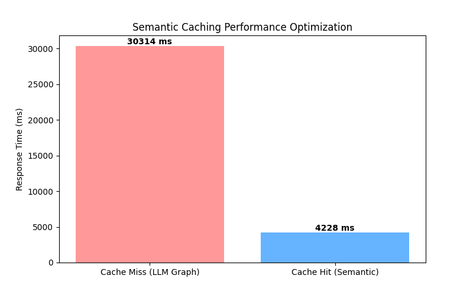

# Historical semantic-cache benchmark

Source: [the original chart](artifacts/semantic-cache-historical.png) and
[`semantic_caching_test.py` at `1c5e5ba`](https://github.com/tangerineYR/antutor/blob/1c5e5ba/performance_test/semantic_caching_test.py).
These are historical Git artifacts, not measurements of the current cache.
The image identity is recorded in [data-provenance.md](data-provenance.md).

| Condition | Reported time |
|---|---:|
| Cache miss / full LLM graph | 30.314 s |
| Cache hit / semantic reuse | 4.228 s |
| Relative reduction `(30314-4228)/30314 × 100` | 86.0526% (approximately 86.1%) |

## Measurement procedure

The historical script sends two sequential `POST /chat` requests with differently
worded descriptions of inflation. They use separate users/sessions and wait
1.5 seconds between requests. Client elapsed time is measured with `time.time()`.
Chart labels truncate durations to integer milliseconds.

There is one request per condition in the script, with no repeated-run variance
or confidence interval. The script clears selected session logs and concept cache
entries before the requests. This cross-session reuse scenario belongs to the old
broad cache; the current learner/session/state-scoped synthesis cache intentionally
prevents such reuse.

## Limits

- The commit preserves the chart and procedure, but no run ID links the image to
  an exact server commit, GPU, model revision or vLLM image digest.
- The script prints HTTP errors but still returns a duration, and does not assert
  `from_cache`. The image alone cannot verify request success or an actual hit.
- No raw timing samples, response logs or concurrent-user statistics are preserved
  with the chart. The two bars are not a multi-user load-test average.
- The numbers do not establish current-version latency or performance of the
  subsequent 14B deployment.

The historical script deletes selected database records and is linked for
inspection, not included as a current executable test. Current cache correctness
is covered separately by [test_semantic_cache.py](../../tests/test_semantic_cache.py).
